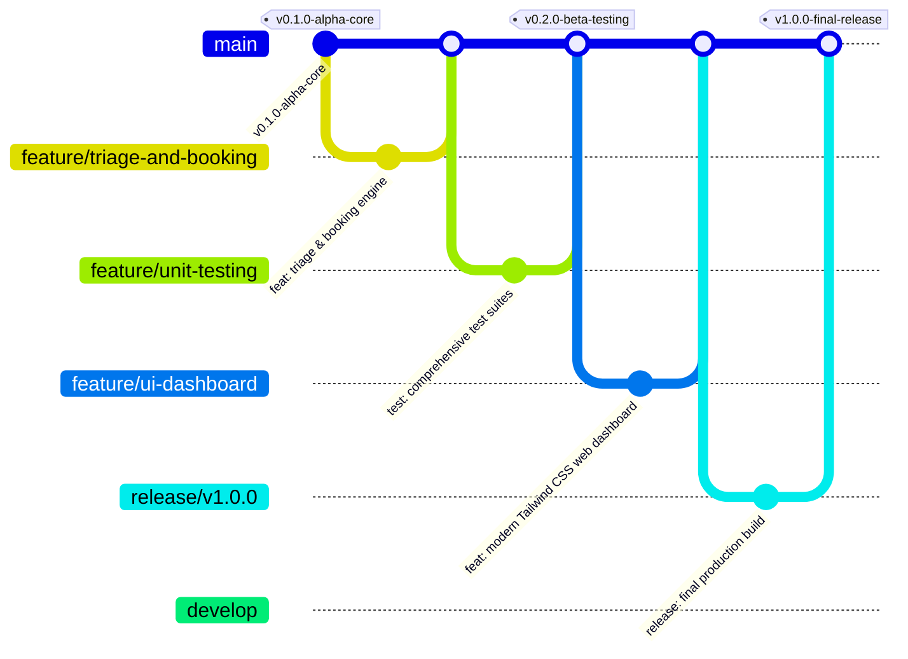

# Secure Patient Appointment & Triage Management System

A production-grade, secure clinical appointment and emergency triage management system implemented in Python 3.10+ using SQLite, adhering to Clean Architecture and SOLID principles.

---

## 📋 Table of Contents
1. [Project Overview](#project-overview)
2. [Architecture & Technology Stack](#architecture--technology-stack)
3. [Modern Web UI (Tailwind CSS Dashboard)](#modern-web-ui-tailwind-css-dashboard)
4. [Component Breakdown](#component-breakdown)
5. [Triage Scoring Algorithm (Part A)](#triage-scoring-algorithm-part-a)
6. [Appointment Scheduling & Emergency Conflict Preemption](#appointment-scheduling--emergency-conflict-preemption)
7. [Security & Data Integrity](#security--data-integrity)
8. [Testing Strategy (Part B - 75 PyTests)](#testing-strategy-part-b---75-pytests)
9. [Git Version Control & Branching Workflow (Part C)](#git-version-control--branching-workflow-part-c)
10. [Step-by-Step GitHub Push Guide](#step-by-step-github-push-guide)
11. [Installation & Execution Guide](#installation--execution-guide)

---

## 1. Project Overview
This system provides an end-to-end clinical triage intake and doctor appointment scheduling engine with both a high-fidelity **Tailwind CSS Web Dashboard** and a **Command Line Interface**. It deterministically classifies patient urgency inspired by the **Emergency Severity Index (ESI)**, guarantees strict collision-free consultation scheduling, and implements automated priority-queue preemption when life-threatening emergency patients arrive.

---

## 2. Architecture & Technology Stack
- **Language:** Python 3.10+
- **Web Framework:** Flask 3.0+ (`app.py`, `src/web_app.py`)
- **Frontend UI:** Tailwind CSS (CDN), FontAwesome 6, Google Fonts (*Plus Jakarta Sans*)
- **Database:** SQLite 3 (native standard library `sqlite3` with foreign key integrity `PRAGMA foreign_keys = ON;`)
- **Security:** Standard library `hashlib.pbkdf2_hmac` (SHA-256 with dynamic 16-byte random salts, 100,000 iterations) + HMAC-SHA256 for clinical record tamper detection
- **Testing:** `pytest` (75 comprehensive unit and integration tests covering branch analysis, boundary value analysis, equivalence partitioning, security, and web routes)

---

## 3. Modern Web UI (Tailwind CSS Dashboard)

The web dashboard is designed with a modern clinical aesthetic using a Slate/Cyan/Emerald palette, responsive glassmorphic cards, and dynamic state badges:

1. **Intake & Triage Calculator (`/dashboard`)**:
   - Demographic intake with immediate physiological bounds checks.
   - Interactive Visual Analog Pain Scale (VAS 0-10) with real-time numeric output.
   - Live async calculation card (`/api/evaluate_triage`) displaying ESI Category, Priority Score (100/75/50/20), Recommended Wait Limit, and Clinical Rationale.
   - KPI metric stat counters for total patients, critical emergencies, scheduled consults, and on-duty doctors.

2. **Appointment Scheduling & Conflict Engine (`/appointments`)**:
   - Consultation booking with doctor availability filtering (08:00 - 18:00).
   - Conflict Detection Toast: Visual rejection banner upon double-booking collision.
   - Emergency Preemption Demonstration: One-click simulation of Category 1 critical patients overriding routine bookings and automatically rescheduling displaced patients.

3. **Patient Registry & HMAC Integrity Audit (`/patients`)**:
   - Comprehensive searchable data table.
   - HMAC-SHA256 digital signature badge displaying real-time tamper verification status for every triage record.

4. **Medical Staff Authentication (`/login`)**:
   - Staff login with PBKDF2-HMAC-SHA256 verification and quick-fill demo credential badges for Doctors, Triage Nurses, and System Administrators.

---

## 4. Component Breakdown

| Module | Responsibility | Key Classes / Functions |
|---|---|---|
| `app.py` / `src/web_app.py` | Flask Web Controller & API Endpoints | `dashboard()`, `process_triage()`, `api_evaluate_triage()`, `book_appointment_route()`, `simulate_conflict_demo()` |
| `src/models.py` | Type definitions and validation models | `User`, `Patient`, `TriageVitals`, `TriageResult`, `Appointment`, `UserRole`, `TriageCategory`, `AppointmentStatus` |
| `src/database.py` | SQLite schema management & transactions | `DatabaseManager` |
| `src/auth_security.py` | PBKDF2 password hashing & RBAC | `hash_password()`, `verify_password()`, `register_user()`, `authenticate_user()`, `verify_record_checksum()` |
| `src/triage_engine.py` | ESI-inspired deterministic triage algorithm | `evaluate_triage()`, `record_patient_triage()` |
| `src/appointment_manager.py` | Slot allocation & emergency preemption | `AppointmentManager.schedule_appointment()`, `find_next_available_slot()` |
| `src/main.py` | CLI demonstration & validation pipeline | `run_demonstration()`, `interactive_menu()` |

---

## 5. Triage Scoring Algorithm (Part A)

The triage engine implements a deterministic rule hierarchy:

| Category | Clinical Label | Decision Rule Criteria | Priority Score | Max Recommended Wait |
|---|---|---|---|---|
| **Category 1** | Resuscitation / Immediate | $\text{SpO}_2 < 90\%$ **OR** $\text{HR} > 140\text{ bpm}$ **OR** $\text{Systolic BP} < 80\text{ mmHg}$ | **100** | **0 min** (Immediate) |
| **Category 2** | Emergent | $90\% \le \text{SpO}_2 \le 94\%$ **OR** $110 \le \text{HR} \le 140\text{ bpm}$ **OR** $\text{Pain Score} \ge 8$ | **75** | **15 min** |
| **Category 3** | Urgent | $100 \le \text{HR} \le 109\text{ bpm}$ **OR** $5 \le \text{Pain Score} \le 7$ | **50** | **60 min** |
| **Category 4** | Non-Urgent / Routine | All vitals within normal parameters ($\text{SpO}_2 \ge 95\%$, $\text{HR} < 100$, $\text{SBP} \ge 80$, $\text{Pain} \le 4$) | **20** | **120 min** |

---

## 6. Appointment Scheduling & Emergency Conflict Preemption

1. **Strict Conflict Detection:** Double-booking is strictly disallowed for standard consultations with the same doctor.
2. **Priority-Queue Override:**
   - When a **Category 1 (Score 100)** or **Category 2 (Score 75)** patient arrives requiring an already-booked time slot:
   - The engine assesses the priority of the currently scheduled patient.
   - If the incoming patient has strictly higher triage priority, the existing routine patient is preempted and automatically rescheduled to the next vacant 30-minute interval.
   - The emergency patient is immediately allocated into the requested prime slot.

---

## 7. Security & Data Integrity

- **Password Hashing:** `hashlib.pbkdf2_hmac` using `SHA-256`, 100,000 iterations, and a unique 16-byte cryptographically secure random salt generated via `secrets.token_hex(16)`.
- **Timing Attack Mitigation:** Authentication comparison performed via `hmac.compare_digest`.
- **Role-Based Access Control (RBAC):** Restricts operations across `Doctor`, `Triage_Nurse`, and `Admin`.
- **Data Tamper Detection:** Generates and verifies HMAC-SHA256 checksums on all clinical triage records upon database insertion.

---

## 8. Testing Strategy (Part B - 75 PyTests)

The test suite contains **75 unit and integration tests** executed using `pytest`:

### White-Box Testing (`tests/test_triage.py`)
- **100% Branch Coverage:** Evaluates every logical `if/elif/else` condition and compound branch in the triage decision tree.
- **Boundary Value Analysis (BVA):** Exhaustive boundary tests at critical transition cutoffs:
  - $\text{SpO}_2 \in \{89.0\%, 89.9\%, 90.0\%, 94.0\%, 94.1\%, 95.0\%\}$
  - $\text{Heart Rate} \in \{99, 100, 109, 110, 140, 141\}\text{ bpm}$
  - $\text{Systolic BP} \in \{79, 80, 81\}\text{ mmHg}$
  - $\text{Pain Score} \in \{0, 4, 5, 7, 8, 10\}$

### Black-Box Testing (`tests/test_appointments.py`)
- **Equivalence Partitioning:** Valid working hours ($08:00 - 18:00$) vs. invalid early/late timestamps and invalid interval offsets ($10:15$).
- **Collision & Overlap Rejection:** Verifies `AppointmentConflictError` upon double-booking.
- **Emergency Preemption:** Verifies automated displacement and rescheduling of routine patients.
- **Exception Verification:** Verifies `ResourceNotFoundError` and `AppointmentValidationError`.

### Web & Integration Testing (`tests/test_web.py`)
- Routing, template rendering, JSON API responses (`/api/evaluate_triage`), and session authentication.

---

## 9. Git Version Control & Branching Workflow (Part C)

The repository follows GitFlow branching standards:



---

## 10. Step-by-Step GitHub Push Guide

To push this project to your GitHub repository, execute the following commands in your terminal:

```bash
# 1. Add your remote GitHub repository URL
git remote add origin https://github.com/YOUR_USERNAME/YOUR_REPOSITORY.git

# 2. Push all branches (main, develop, feature branches)
git push -u origin --all

# 3. Push all milestone tags (v0.1.0-alpha-core, v0.2.0-beta-testing, v1.0.0-final-release)
git push origin --tags
```

---

## 11. Installation & Execution Guide

### 1. Install Dependencies
```bash
pip install -r requirements.txt
```

### 2. Launch Web Application Dashboard (Recommended)
```bash
python app.py
```
Open your browser at **`http://127.0.0.1:5000`** to access the Tailwind CSS web dashboard.

### 3. Run Automated CLI Demo (Part A Scenarios)
```bash
python -m src.main
```

### 4. Run PyTest Unit Test Suites (Part B)
```bash
python -m pytest -v
```

